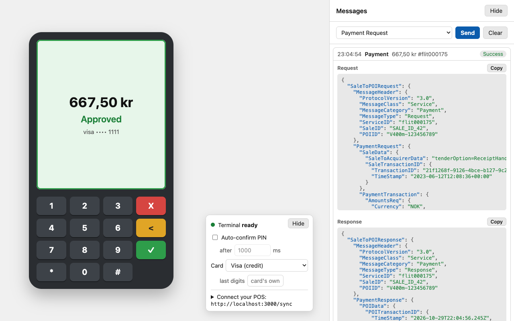

> **[!IMPORTANT]** This mock application is currently in its alpha-release and is **not** supporting every terminal-api request and response. This application **cannot** reject all invalid requests.
> 
> **Always test** your request and responses on your own physical terminal device first. 

# Adyen Mock Terminal-API Application
The Adyen Mock Terminal-API Application is a mock server that handles incoming requests and returns hard-coded responses. The application matches the request by looking at the `SaleToPOIRequest.MessageCategory`-field and returns the respective response, see `/public/payloads/...`-folder.

This tool can be used by developers to quickly end-to-end test their application by sending having their application send requests to the Mock Terminal API Application (`http://localhost:3000/sync`) instead of the Adyen servers. You can do this by overriding the `CloudApiEndpoint` on the client (config) of your application.

Currently, we use the Mock Terminal-API Application to [end-to-end test](https://github.com/adyen-examples/adyen-testing-suite/tree/main/tests/in-person-payments) our in-person payments integration-examples in [**.NET**](https://github.com/adyen-examples/adyen-dotnet-online-payments/tree/main/in-person-payments-example), [**Java**](https://github.com/adyen-examples/adyen-java-spring-online-payments/tree/main/in-person-payments-example) or [**Node.js**](https://github.com/adyen-examples/adyen-node-online-payments/tree/main/in-person-payments-example).



### The page
One screen, laid out like the [virtual thermal printer](https://github.com/christiandt/virtual-thermal-printer), in light or dark mode as the system:
- **The terminal**, in the middle. Its screen shows the amount of the payment waiting for a PIN, the PIN as it is entered, and then the outcome ("Approved", "Declined", "Cancelled", "Aborted") with the card.
- **The device panel**, beside it: the terminal's state, auto-confirm, the card, and the URL to connect a POS to. It can be hidden.
- **Messages**, on the right: every `/sync` exchange (newest first) as one line with its result, which opens to the request and response JSON. A sample request can be sent from the top. The pane can be hidden.

The list comes from `GET /user-interaction/messages` (the latest 100; with `?version=<n>` an unchanged list returns only `{ version }`), and the screen from `GET /user-interaction/get-state`, which also returns the payment in progress and how the last one ended.


## Supported Requests/Responses

### Basics
We currently support the following [Terminal API requests/responses](https://docs.adyen.com/point-of-sale/design-your-integration/terminal-api/) below.


|                                                                                                                                                            Request | Response                                                                                                                                                             | Description                                                                                                                          |
|-------------------------------------------------------------------------------------------------------------------------------------------------------------------:|:---------------------------------------------------------------------------------------------------------------------------------------------------------------------|--------------------------------------------------------------------------------------------------------------------------------------|
|                     [PaymentRequest](https://docs.adyen.com/point-of-sale/design-your-integration/terminal-api/terminal-api-reference/#comadyennexopaymentrequest) | [PaymentResponse](https://docs.adyen.com/point-of-sale/design-your-integration/terminal-api/terminal-api-reference/#comadyennexopaymentresponse)                     | A successful payment request.                                                                                                        |
|                   [ReversalRequest](https://docs.adyen.com/point-of-sale/design-your-integration/terminal-api/terminal-api-reference/#comadyennexoreversalrequest) | [ReversalResponse](https://docs.adyen.com/point-of-sale/design-your-integration/terminal-api/terminal-api-reference/#comadyennexoreversalresponse)                   | A successful reversal request.                                                                                                       |
| [TransactionStatusRequest](https://docs.adyen.com/point-of-sale/design-your-integration/terminal-api/terminal-api-reference/#comadyennexotransactionstatusrequest) | [TransactionStatusResponse](https://docs.adyen.com/point-of-sale/design-your-integration/terminal-api/terminal-api-reference/#comadyennexotransactionstatusresponse) | The result of the transaction its `MessageReference` names, see below.                                                             |
|                                                                                                                                                                    | [PaymentBusyResponse](https://docs.adyen.com/point-of-sale/design-your-integration/terminal-api/terminal-api-reference/#comadyennexopaymentresponse)                 | Returned for a payment or reversal while the terminal is waiting for a PIN.                                                          |
|                         [AbortRequest](https://docs.adyen.com/point-of-sale/design-your-integration/terminal-api/terminal-api-reference/#comadyennexoabortrequest) |                                                                                                                                                                      | Cancels the in-progress payment its `MessageReference` names: `200 OK` with no body, and that payment ends as `Aborted`.            | 

### Responses answer the request
The payloads are recorded responses, but each response is built for the request it answers, as a terminal would:
- The `MessageHeader` carries the request's `ServiceID`, `SaleID` and `POIID`.
- A `PaymentResponse` returns the request's `SaleTransactionID` unchanged, and a new `POITransactionID` in Adyen's format `<tender reference>.<PSP reference>` (e.g. `MoCk001761750000001.CWBC43ZX2VTFWR82`), with a new 16-character PSP reference, also in `AcquirerTransactionID`.
- An approved payment is authorised for exactly the `RequestedAmount` and `Currency`, on Adyen's Visa test card (`411111 **** 1111`) in `CardData`. Its `AdditionalResponse` holds `pspReference`, `merchantReference`, `paymentMethod`, `cardBin`, `cardSummary`, `posAuthAmountValue` and `posOriginalAmountValue` (in the currency's minor units, per [Adyen's currency table](https://docs.adyen.com/development-resources/currency-codes)), and so on.
- A refused payment keeps its recorded refusal reason.
- A `ReversalResponse` gets its own PSP reference in `POITransactionID`.

The `AdditionalResponse` is always form-encoded key-value pairs. That is what Adyen returns when the request's `SaleToAcquirerData` is key-value pairs or absent. A request with Base64-encoded JSON `SaleToAcquirerData` would get Base64-encoded JSON from Adyen; the mock does not do that yet.

### Transaction state
The mock remembers the payments and reversals it has handled (the latest 1000), as a terminal does:
- **TransactionStatusRequest** for the `SaleID` and `ServiceID` in its `MessageReference` (as [Adyen describes it](https://docs.adyen.com/point-of-sale/basic-tapi-integration/verify-transaction-status)):
  - the transaction ended: `Success`, with the original response in `RepeatedMessageResponse` (`MessageHeader` and `RepeatedResponseMessageBody`);
  - the payment is still waiting for the PIN: `Failure` / `InProgress`, with its `tenderReference` in the `AdditionalResponse`. A status request is answered while a payment is in progress;
  - unknown, or no `MessageReference`: `Failure` / `NotFound`, "Message not found".
- **AbortRequest**: answered with `200 OK` and no body. The payment it names ends as `Failure` / `Aborted`; one with another `ServiceID` carries on.
- **Cancel** (the red button on the terminal screen): the payment ends as `Failure` / `Cancel`, `refusalReason=Shopper cancelled`.
- **Time-out**: a payment nobody enters a PIN for ends as `Failure` / `Cancel`, which Adyen uses for device time-outs, after `PIN_TIMEOUT_SECONDS` (default 180).
- **ReversalRequest**: the `AdditionalResponse` holds `posOriginalAmountValue`, the reversed payment's amount in minor units.

### Auto-confirm (automated tests)
With auto-confirm on, a payment is confirmed as if a PIN were entered, after a delay, so automated tests need not drive the terminal screen. Amounts ending in a refusal code are still refused, and a `TransactionStatusRequest` or `AbortRequest` can be sent during the delay.
- At start-up: `AUTO_CONFIRM=true` and `AUTO_CONFIRM_DELAY_MS` (default `1000`, 0–60000).
- At runtime: `GET /user-interaction/settings` returns `{ "autoConfirm": false, "autoConfirmDelayMs": 1000 }`; `POST` changes any of them, e.g. `{ "autoConfirm": true, "autoConfirmDelayMs": 0 }`. An invalid value is answered `400` with an `error`.
- On the page: the "Auto-confirm PIN" checkbox.

### Card
The card a payment is made with is a terminal setting, `card`. An approved payment carries it in `CardData` (`PaymentBrand`, `MaskedPan`) and in the `AdditionalResponse` (`paymentMethod`, `paymentMethodVariant`, `cardBin`, `cardSummary`, `fundingSource`). A refused payment shows it in `CardData` too.

| `card` | `paymentMethod` | `paymentMethodVariant` | Card |
|---|---|---|---|
| `visa` (default) | `visa` | `visacredit` | `411111 **** 1111`, Adyen's Visa test card |
| `visadebit` | `visa` | `visadebit` | `457173 **** 0004` |
| `mc` | `mc` | `mc` | `555544 **** 4444` |
| `mcdebit` | `mc` | `mcdebit` | `520082 **** 0008` |
| `maestro` | `maestro` | `maestro` | `600007 **** 7003` |
| `amex` | `amex` | `amex` | `370000 **** 0002` |
| `vpay` | `vpay` | `vpay` | `482000 **** 0006` |
| `bankaxept` | `bankaxept` | `bankaxept` | `672000 **** 0016` |

The identifiers are from [Adyen's list](https://docs.adyen.com/development-resources/paymentmethodvariant), which gives BankAxept only as a variant; its `paymentMethod` is assumed to be `bankaxept` too. The card numbers are illustrative, apart from the Visa test card.
- At start-up: `CARD` (one of the above) and `CARD_LAST4` (four digits instead of the card's own).
- At runtime: `POST /user-interaction/settings` with `{ "card": "mc", "cardLast4": "4242" }` (`null` restores the card's own digits). `GET /user-interaction/cards` lists the cards.
- On the page: the "Card" menu.

### Declined payments
In general, test payments generate the result Approved. To simulate declined payments, you can change the last three digits of the `RequestedAmount` that you specify in the payment request.
- We constructed the mock payloads using a `V400M-` terminal device.
- We used the `Blue-green Adyen point-of-sale test card` (card inserted & pin entered, no tap) to retrieve the responses.

We currently support the following [Payment Refusal Codes](https://docs.adyen.com/point-of-sale/testing-pos-payments/test-card-v1/#testing-declines), see below.


|  Amount ending in | Result       | Error Condition | Refusal Reason         | Message                                                                                                                                            |
|------------------:|--------------|-----------------|------------------------|----------------------------------------------------------------------------------------------------------------------------------------------------|
|           **124** | Failure      | Refusal         | 210 Not enough balance | NOT_ENOUGH_BALANCE                                                                                                                                 |
|           **125** | Failure      | Refusal         | 199 Card blocked       | BLOCK_CARD                                                                                                                                         |
|           **126** | Failure      | Refusal         | 228 Card expired       | CARD_EXPIRED                                                                                                                                       |
|           **127** | Failure      | Refusal         | 214 Declined online    | INVALID_AMOUNT                                                                                                                                     |
|           **128** | Failure      | InvalidCard     | 214 Declined online    | INVALID_CARD                                                                                                                                       |
|           **134** | Failure      | WrongPIN        | 129 Invalid online PIN | INVALID_PIN - **Remark:** The terminal shows "Incorrect PIN" and then "Enter PIN". Cancel the payment on the terminal to get the failure response. |

When an invalid JSON is provided, an `invalidJsonObjectNotificationResponse` is returned.


## Prerequisites
- Node.js 18+ 

> We recommend to use an application that can send Terminal-API requests or one of our [**.NET**](https://github.com/adyen-examples/adyen-dotnet-online-payments/tree/main/in-person-payments-example), [**Java**](https://github.com/adyen-examples/adyen-java-spring-online-payments/tree/main/in-person-payments-example), [**Node.js**](https://github.com/adyen-examples/adyen-node-online-payments/tree/main/in-person-payments-example) example-integrations.

## 1. Installation

```
git clone https://github.com/adyen-examples/adyen-mock-terminal-api.git
```


## 2. Run the Application

```
npm install
npm start
```

Visit [http://localhost:3000/](http://localhost:3000/) to see the mock Terminal API.

## 3. Usage

There are two ways in which you can use the application.

1. We recommend to clone one of our In-Person Payment Integration examples in [**.NET**](https://github.com/adyen-examples/adyen-dotnet-online-payments/tree/main/in-person-payments-example), [**Java**](https://github.com/adyen-examples/adyen-java-spring-online-payments/tree/main/in-person-payments-example) or [**Node.js**](https://github.com/adyen-examples/adyen-node-online-payments/tree/main/in-person-payments-example).

Once you've cloned the example, you can point the application to use `http://localhost:3000`, this configurable by overriding the `CloudApiEndpoint` URI. Now your application is ready to communicate to the terminal


2. Alternatively, you can use this stand-alone application and send terminal API requests from within the application.


### Run Docker Image

You can also run the `adyen-mock-terminal-api` in a Docker container which exposes the application on port 3000 (default).


```
  # Run on Mac (i.e. --platform linux/arm64/v8)
 docker run --rm -d --name adyen-mock-terminal-api -p 3000:3000 -e PORT=3000 ghcr.io/adyen-examples/adyen-mock-terminal-api:main
```


## Contributing

We commit all our new features directly into our GitHub repository. Feel free to request or suggest new features or code changes yourself as well! Find out more in our [contributing](https://github.com/adyen-examples/.github/blob/main/CONTRIBUTING.md) guidelines.


### Example: Add your own mock request/response payload

1. Fork this repository and create a new branch.
2. The example below adds `paymentRequest.json` and `paymentResponse.json`. The `src/routes/services/payloadService` will automatically load these files, if it's suffixed with `*Request`/`*Response` **and** if the JSON is valid.
   - Create a new folder, in this example we use the existing **{payment}**-folder.
   - Add your `Request` to `/public/payloads/**{payment}**/paymentRequest
   - Add your `Response` to `/public/payloads/**{payment}**/paymentResponse
   - **Note:** Every `*Request` should have a `*Response`, except for those that require some kind of state or logic (f.e: "paymentBusyResponse" triggers when a payment request is in-progress).
   - **Note 2:** Keep naming-conventions camelCased and prefixed with its root-folder. Example: if the root-folder is located in `/payloads/example`, we name the jsons accordingly: `exampleRequest.json`/`exampleResponse.json`. 
3. In `/src/routes/defaultRoutes.js`, find the `/sync`-endpoint and add the logic needed to map your requests-and-responses.

```js
if (req.body.SaleToPOIRequest.Request) {
    sendOKResponse(res, "payment");
    return;
}

if (req.body.SaleToPOIRequest.ExampleRequest) {
   sendOKResponse(res, "example");
   return;
}
```
3. Open a [Pull Request](https://github.com/adyen-examples/adyen-mock-terminal-api/compare) with your changes.


## License

MIT license. For more information, see the **LICENSE** file.
